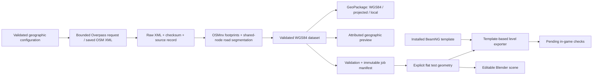

# Initial architecture

The package uses a src layout. Acquisition is in `providers`, transforms and preview
in `geospatial`, typed contracts in `models`, atomic storage in `storage`, geometry
in `generation`, and output-specific serialization in `exporters`.

The offline XML path and live provider share extraction code. OSMnx assembles building
multipolygons. The road layer splits original ways at shared node IDs, retaining
all source nodes, highway classifications, access, lanes, bridge/layer tags, and direction.
No shortest-path or traffic functionality is claimed.

Full buildings and complete road segments intersecting the area are retained rather than
cutting original footprints at a boundary. Test road surfaces are clipped at export. A future
chunk ownership scheme must deduplicate features by persistent ID when combining adjacent jobs.

## Coordinates and elevation

Source geometry is EPSG:4326, processing is EPSG:32651 (UTM 51N).
Every PyProj transformer explicitly uses longitude/easting first (`always_xy=True`).
Local X = easting minus origin easting; local Y = northing minus origin northing;
local Z = source elevation minus origin elevation, with Z up.
The Z operation is a translation, not a geoid or vertical datum conversion.

Projected GeoPackage layers carry UTM. Local layers carry an **engineering CRS**, not
a falsely assigned UTM identifier. Use the dataset origin/CRS or manifest to georeference
them. The source has no measured terrain elevations. The export pad's Z=0 is explicitly
an artificial engineering test surface, not a flattening operation on a real DEM.

## Checkpoints and failure behavior

Raw caches are named by endpoint + query hash, or by content hash for offline imports.
Sources preserve acquisition time, OSM feature versions/timestamps where available,
source checksum, license, attribution, and query. Credentials are not accepted in endpoint URLs.

Processed job IDs include source content, synthetic status, geographic configuration,
pipeline version, and core geospatial dependency versions. A staging directory is published
only after outputs and their checksums are written. Failed jobs leave previous jobs intact.
Repeat runs validate and reuse existing output. Increment the pipeline version when output
semantics change in a released implementation.

The export uses its own staging directory and refuses to overwrite an existing output.
It reads a small allowlist of shipped template members; it never extracts arbitrary ZIP paths.

## Planned modules

Licensed-image ingestion, reconstruction workers, terrain processing, district style libraries,
LOD preparation, manual override application, and geographic chunks will consume explicit stage
contracts. They are not implemented yet. Storing an override field does not imply override
application works. The current pipeline is an offline prototype, not city streaming.

